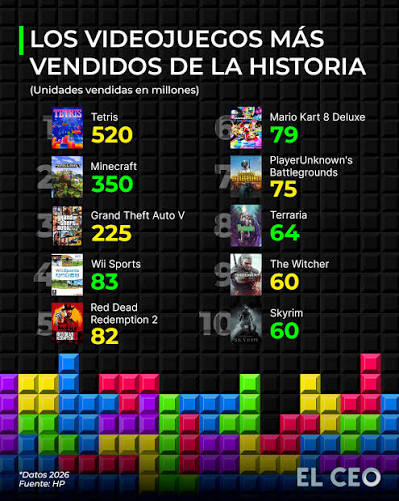
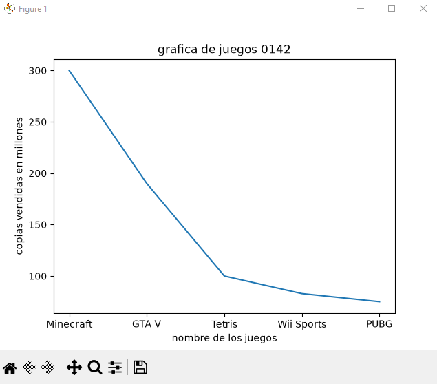
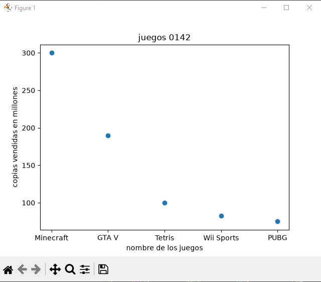
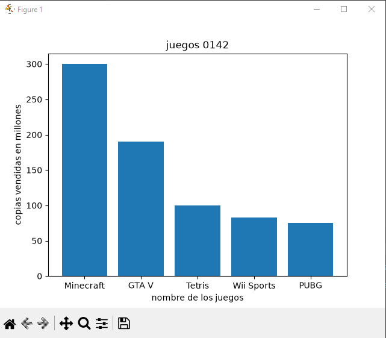
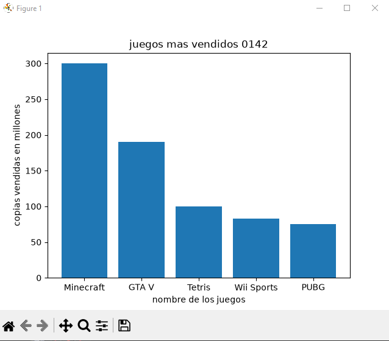
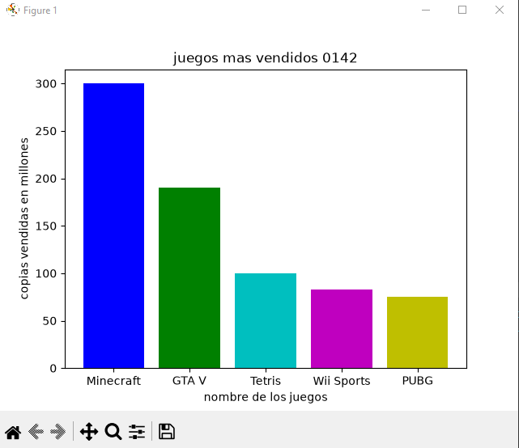
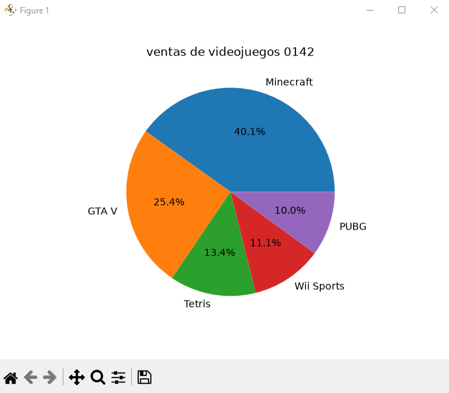

## dataframe o marco de datos panda

## redes sociales a nivel global

## grafica lineal de videojuegos 

## grafica de puntos de videojuegos

## grafica de barras de videojuegos

## grafica de barras del mas grande al mas chico de forma descendente

## coloreando la grafica 

## grafica de pastel o pie 

## gracias por revisarme profe 
